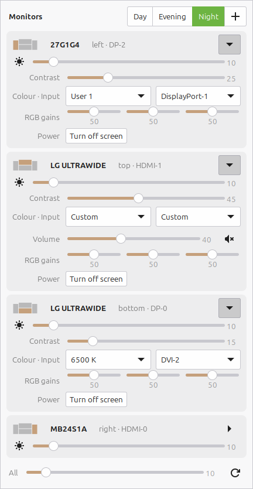

# monitor-panel

A popup for the xfce4 panel that controls every DDC/CI monitor on the desk.



- One card per monitor: name, a mini map of where it sits, and brightness up front.
- Behind the arrow: contrast, colour preset, input source, speaker volume and mute,
  RGB gains, and a "turn off screen" button. Only what the monitor reports is shown.
- Profiles (Day / Evening / Night seeded) apply to all monitors in one click;
  right-click a chip to rename, delete, or overwrite it with the current settings,
  `+` saves the current settings as a new one. The matching profile is highlighted.
- An "All" slider moves every monitor's brightness together.
- Click a monitor's name to rename it.
- Opens next to the pointer; closes on Escape, on clicking elsewhere, or on a second
  click of the panel button.

Monitors are keyed by EDID and matched to xrandr outputs, so the mapping survives
reboots and bus renumbering. Capabilities and the bus map are cached in
`~/.cache/monitor-panel` so the popup opens instantly; profiles, names and expanded
rows live in `~/.config/monitor-panel/config.json`.

## Install

```sh
sudo apt install ddcutil python3-gi gir1.2-gtk-3.0
sudo usermod -aG i2c $USER        # then log out and back in
ln -s "$PWD/monitor-panel" ~/.local/bin/monitor-panel
```

Add a Launcher to the xfce4 panel and point it at `monitor-panel.desktop` (or set its
command to `monitor-panel`). The refresh button inside the popup re-runs `ddcutil detect`
after plugging in a monitor.

## Notes

- Writing RGB gains switches most monitors to their "User" preset, so profiles only
  store gains when the monitor is already in User mode. Input and power are never part
  of a profile.
- ddcutil 1.4 has no cross-process bus locking; the app serialises calls per bus and
  coalesces slider writes into single `setvcp` calls.
- Every drop-down is a GtkPopover, not a GtkMenu: a menu would take focus away and
  close the popup.
