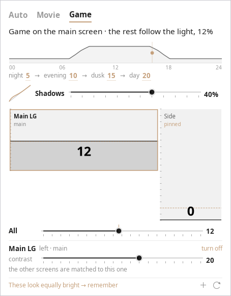

# monitor-panel

A popup for the xfce4 panel that controls every DDC/CI monitor on the desk.



The popup reads top to bottom in the order things are needed. It is drawn quietly on
purpose: no boxes or button chrome, one accent colour, hairlines, and the ink spent on
the levels themselves.

- **Mode**: `Auto  Movie  Game` as three words, the current one underlined.
  A mode belongs to the configured main monitor (tagged `main`).
  - **Auto**: every screen follows the light (see the day curve), with **20% contrast**.
  - **Movie**: main monitor at **50% brightness / 50% contrast**.
  - **Game**: main monitor keeps its automatic backlight and gets a shadow lift.
- **One sentence** for what that means right now ("Following the light, 11%"), with
  any service error under it in warning colour. Hover for the light reading.
- **Today's curve and its four numbers**: automatic brightness from midnight to
  midnight. The line is a clear day computed from the sun's height; the dot is the
  level the light asks for now, so a dot under the line is an overcast day. Under it:
  `night 5 → evening 10 → dusk 15 → day 20`. Drag a number sideways (or scroll over
  it) to change it; the curve and the screens follow while you move. A number pushes
  its neighbours along so that brighter light never means a darker screen.
- **Shadows** (shown only in Game): off, then 10–100%, default 40, next to a small
  plot of the tone curve it applies (diagonal = untouched picture). It brightens only
  the dark end; midtones, highlights, white, black and the colour tint stay put.
- **The desk**: every screen drawn where it stands, to scale, and each one is its own
  brightness control. A screen is filled from the bottom as far as its brightness
  reaches, on one notched scale shared by all of them, with the number riding on the
  level. Drag a screen up or down, or scroll over it, to set it. The dashed line is
  where automatic brightness wants that screen. Click a screen to bring up its
  contrast, speaker volume/mute, name (click to rename) and "turn off" below.
  Colour presets, input switching and RGB gains are deliberately not in the panel.
- **All** track: every screen together.
- **Monitors with broken remote contrast**: `"quirks": {"<EDID key>": {"12": {"max": N,
  "auto": N, "shown_offset": N}}}` in `config.json` limits what is sent, sets what
  automatic contrast means there, and shows the monitor's own menu numbers. Written for
  an HKC MB24S1A whose firmware stored a DDC contrast as value+78; that one was later
  fixed in the firmware itself, see
  [hkc-mb24s1a-firmware-fix](https://github.com/nuxdie/hkc-mb24s1a-firmware-fix).
  Every feature is written in its own DDC call, because that monitor drops one from a
  combined write.
- **Notches**: everything stops on preferred numbers (Renard R10):
  0 1 2 3 4 5 6 8 10 13 16 20 25 32 40 50 63 80 100. Each is about a quarter more than
  the last, which is one equal-looking step. A level set elsewhere (automatic 11%,
  say) is shown where it is, in between.
- **Pins**: setting a screen by hand pins it there; it says `pinned` on the desk and
  `pinned · unpin` in its details (`unpin all` appears with two or more). Switching
  mode never clears other monitors' pins. Tuning the main monitor inside Movie/Game
  belongs to that mode and is dropped when you leave it.
- **Matching different monitors**: the same number is not the same brightness on
  panels from different makers. Set the screens by eye until they look alike and press
  **These look equally bright → remember**. Each other monitor then stores a pair
  "value here = level on main"; automatic brightness and the All track go through
  those pairs. One pair shifts that monitor's scale; a second one taken at a clearly
  different level (once dim, once bright) fits a line, up to four are kept, and a new
  judgement replaces an old one at about the same level. With the main monitor on
  automatic, remembering also replaces the matched monitors' pins. A screen's details
  show its pairs and a `forget` link. This equalises backlight level only, not white
  point or contrast response; those need a colorimeter and ICC profiles.
- `+` saves the current settings of every screen as a preset; right-click a preset
  to rename, delete, or overwrite it.
- Opens next to the pointer; closes on Escape, on clicking elsewhere, or on a second
  click of the panel button.

Monitors are keyed by EDID and matched to xrandr outputs, so the mapping survives
reboots and bus renumbering. Capabilities and the bus map are cached in
`~/.cache/monitor-panel` so the popup opens instantly; profiles, names and expanded
rows live in `~/.config/monitor-panel/config.json`.

## Automatic lighting

The user service `monitor-ambient.service` samples light approximately every 15 s.
It uses the first fresh source:

1. An optional lux sensor on another machine, read over SSH: set `ambient.lux_ssh`
   (`user@host`) and `ambient.lux_path` (a file holding the latest lux value, default
   `/dev/shm/lux`) in `config.json`. Readings older than 90 s are rejected; an
   unreachable sensor is retried every 2 min.
2. Outdoor solar-radiation estimates for your location from
   [Open-Meteo](https://open-meteo.com/) (CC BY 4.0), fetched every 15 min and
   interpolated between the quarter-hour samples. These are model estimates in
   **W/m²**, not indoor lux. Failed requests retry after 2 min.
3. Locally calculated solar elevation, requiring neither a sensor nor internet.

Brightness is one continuous curve through the owner's four levels, never a step:

- indoor lux, on a log scale: 2.5 lx → night, 12 → evening, 55 → dusk, 200 → day;
- outdoor radiation: 0 W/m² → evening, 30 → dusk, 120 → day, and with the sun below
  the horizon its depth takes over, down to night at −12°;
- sun only: −12° → night, −6° → evening, horizon → dusk, 6° → day.

The result is applied in whole percents with a little stickiness (a reading has to
move three quarters of a percent before the level changes), and the backlight moves
at most two points per round. A sensor in another room is only a proxy and needs
practical calibration.

A slider or a dragged screen is written to the monitor at once by the service itself
(reply in a few ms, on the monitor in 0.1–0.3 s). The service is the only writer of
brightness and contrast, and a round that was already reading with older targets
writes nothing, so a newer value is never pushed back.

The panel displays the active source, phase, overrides, and readback errors.
Persistent monitor identity uses EDID, with fresh DDC detection after layout
changes; all panel/service DDC calls share per-bus file locks. Power/input and
factory colour modes are never changed by Auto, Movie, or Game.

Redshift uses the same gamma ramp as Game and rewrites it every few seconds, so Game
suspends its adjustment process and resumes it on exit. While it is suspended the
service asks Redshift once a minute which colour temperature it wants (`redshift -p`),
applies it to the other screens with Redshift's own one-shot mode, and rebuilds the
main screen's lifted ramp from that, so the evening warmth keeps moving during a long
session without the lift ever dropping. If Redshift is switched off in its tray icon
nothing is followed. The original main-monitor ramp and process identities are saved
before changing anything. Normal shutdown and systemd `ExecStopPost` restore the ramp
and resume Redshift after a crash.

An unreachable light sensor is retried every 2 min rather than every round, so its
timeout does not slow the controls. Mode and Shadows requests are applied the moment
they arrive, not on the next round.

`config.json` holds `"ambient": {"enabled": true, "main_monitor": "<EDID key>",
"latitude": .., "longitude": ..}` (city-level coordinates are plenty; without them a
default is used and the day curve will be off for your location);
mode overrides and live readbacks live in `~/.local/state/monitor-panel/`.
The local control socket is private to the current user.

```sh
ln -s "$PWD/monitor-automation" ~/.local/bin/monitor-automation
cp monitor-ambient.service ~/.config/systemd/user/
systemctl --user daemon-reload
systemctl --user enable --now monitor-ambient.service
monitor-automation status
monitor-automation movie    # or game / auto
monitor-automation release  # unpin every monitor
monitor-automation request '{"op": "shadows", "value": 40}'
monitor-automation request '{"op": "match", "forget": "all"}'
```

Validation: `python3 -m unittest discover -s tests -v` exercises policy, stale
sources, the continuous curve, hardware readback failure, mode/pin scope, matching,
shadow curve, Redshift following and safe recovery.
`xvfb-run -a python3 tests/check_panel_ui.py` checks the GTK controls with fake
monitors, without touching real ones.

## Install

```sh
sudo apt install ddcutil python3-gi gir1.2-gtk-3.0
sudo usermod -aG i2c $USER        # then log out and back in
ln -s "$PWD/monitor-panel" ~/.local/bin/monitor-panel
```

Add a Launcher to the xfce4 panel and point it at `monitor-panel.desktop` (or set its
command to `monitor-panel`). The refresh button inside the popup re-runs `ddcutil detect`
after plugging in a monitor.

## Notes

- Writing RGB gains switches most monitors to their "User" preset, so profiles only
  store gains when the monitor is already in User mode. Input and power are never part
  of a profile.
- ddcutil 1.4 has no cross-process bus locking; the app serialises calls per bus and
  coalesces slider writes into single `setvcp` calls.
- Every drop-down is a GtkPopover, not a GtkMenu: a menu would take focus away and
  close the popup.
